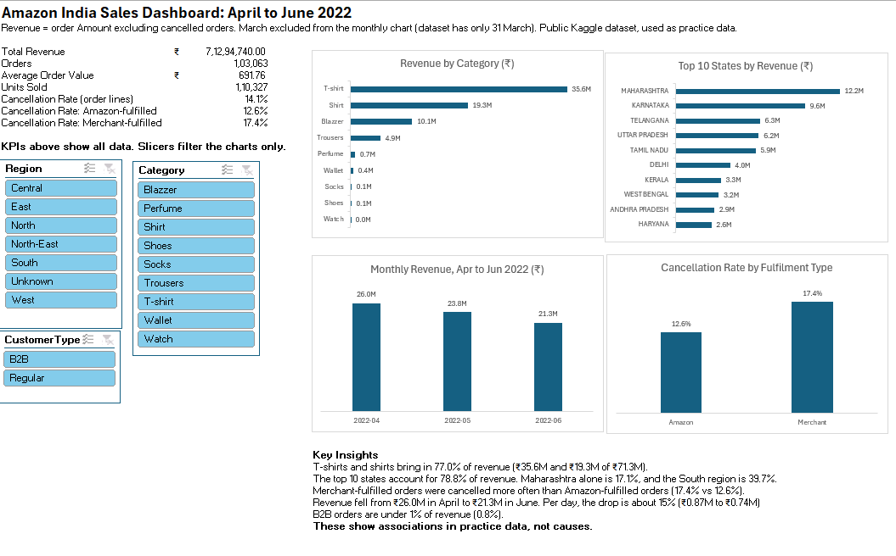

# Amazon India Sales Analysis (Excel)

Cleaned a messy 128,976-row e-commerce sales file with Power Query and built an Excel dashboard (KPIs, four charts, slicers) to answer: which categories and states bring in the most revenue, how revenue changes by month, and whether Amazon- or Merchant-fulfilled orders are cancelled more often.

**Data:** public Kaggle dataset "Amazon Sale Report" (31 Mar to 29 Jun 2022). Used as practice data; not verified as official Amazon data.

## Key findings
- T-shirts and shirts bring in 77.0% of revenue.
- The top 10 states account for 78.8% of revenue; Maharashtra alone is 17.1% and the South region 39.7%.
- Merchant-fulfilled orders were cancelled more often than Amazon-fulfilled orders (17.4% vs 12.6%).
- Revenue fell from Rs 26.0M in April to Rs 21.3M in June; per day the drop is about 15%.
- B2B orders are under 1% of revenue (0.8%).

## What I did
- **Power Query:** removed 5 unused columns and 959 exact duplicates, fixed a Date column that mixed two formats, standardised 69 state spellings to 37 values (and fixed a bug where a replacement corrupted state names), removed a redundant column, and added a Revenue column that excludes cancelled orders.
- **Excel:** Excel Tables, XLOOKUP (state to region, status to status group), SUMIFS / COUNTIFS, UNIQUE / FILTER for distinct order counts, PivotTables, slicers and PivotCharts.
- The workbook also has a **Cleaning Log** and **README** sheet documenting every step.

## Definitions
- **Revenue:** Amount for non-cancelled order lines (cancelled = 0).
- **Orders:** distinct Order IDs among non-cancelled lines.
- **Cancellation rate:** cancelled order lines divided by all order lines.

## Limitations
Only about three months of data; March has a single day and is excluded from the monthly chart; city names are not standardised, so analysis uses state; regions follow India's Zonal Councils and status groups are my own judgement; KPI cards do not react to slicers; findings show associations, not causes.

## Files
- `Amazon_India_Sales_Analysis.xlsx`: the full workbook (Dashboard, Pivots, cleaned data, Lookups, Cleaning Log, README)
- `dashboard_preview.png`: screenshot of the dashboard
